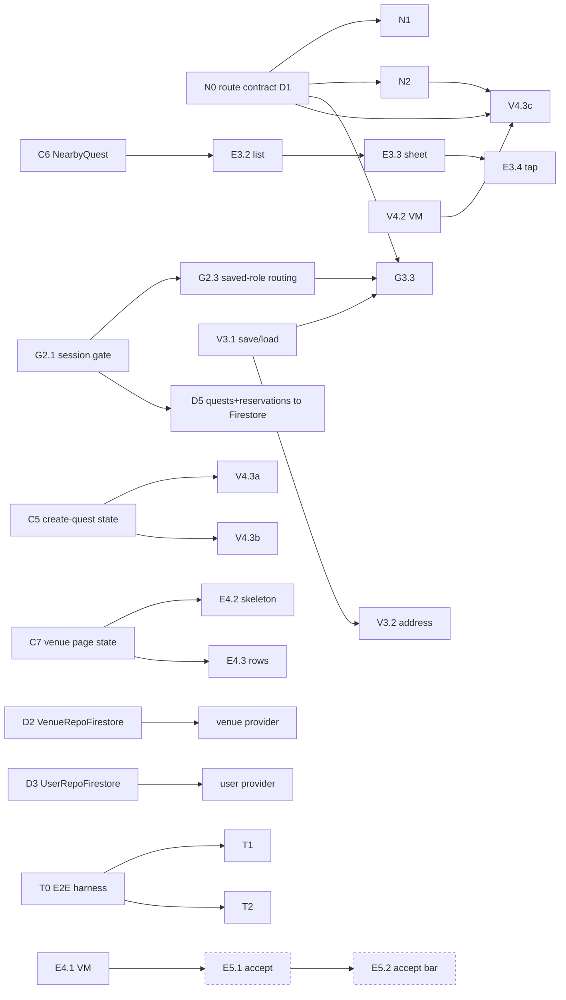

<!-- Co-authored-by: Claude <noreply@anthropic.com> -->

# Sprint 2 plan (draft for team discussion)

> **Status:** proposal. Nothing here exists on GitHub yet. Once the team agrees, each issue below can be
> created as written: parent issues as **User story**, sub-issues as **Task**, with the parent linked
> as a GitHub sub-issue.
>
> **Sizes:** **S** ≈ ½ day, **M** ≈ 1 day, **L** ≈ 2 days. **D1–D7** are the sprint's days.
> **Hard dep** = the work can't start without it. **Soft dep** = the work starts against a fake or a stub,
> and only the final wiring waits.

---

## 0. TL;DR

| Goal | What we deliver | Main stories |
|---|---|---|
| **A** Connect all screens | Create account → explorer tabs → map → venue page, or venue link → venue registration → venue onboarding → venue home. Returning users go straight to their saved role's screens. No dead ends, and sign-out works. | G2, G3, V3, E4 (+ N0–N2) |
| **B** Firestore with real data | Schema v1 merged, rules v2 deployed, real venues and quests in `around-67942`, a seed tool for the emulator | V1, E2 |
| **C** Figma assets as their own tasks | Every asset goes in an **asset-only PR**: design tokens/fonts (DS0), then one import per new screen (A1–A3) | E4, V9, E6 |
| **D** Mocks → Firestore | Every repository provider serves Firestore. `MapDemoData` leaves the app and becomes seed data | V1, E2 |
| **E** End-to-end flow and test | One harness and two journeys: a venue publishes a quest, and an explorer finds it and opens the venue page | V4, E4 |
| **F** *(nice to have)* Accept a quest | Explorer accepts → a reservation (= the party) is created → the venue sees it on its dashboard | E5, V9 (+V10, E6) |

**The single most important change from Sprint 1:** every shared seam (route names, screen signatures,
UI-state classes, asset names) lands on **D1** in a tiny "contract" PR. After that, people build against
the contracts in their **own files**. Nobody edits a file someone else owns this sprint (§2).

---

## 1. Where the codebase stands (analysis)

### 1.1 What exists on `main` (6a2cb9f)

| Area | Exists | Gap |
|---|---|---|
| **App shell** | `MainActivity` → `AroundApp` bottom tabs (Quests, Map, Profile) | No auth gate. Quests and Profile are placeholders (`TODO (Issue #20)` in `AroundApp.kt`) |
| **Auth** | `AuthRepository` + Firebase impl + fake, `AuthViewModel`, `AuthScreen` | Only reachable from the debug-only `AuthDemoActivity`. Session routing is in draft PR **#86** (1,196 additions, 24 files, `large-change`) |
| **Users / roles** | `User`, `Role`, `UserRepository`, `FakeUserRepository` | **No Firestore impl, no provider. Registration doesn't save the account type yet** |
| **Venue onboarding** | `VenueInitializationScreen/ViewModel`, `venueOnboardingDestinations(...)` | **Not registered in any NavHost** (#79). The location slot isn't wired |
| **Venue area (V3)** | `VenueAreaScreen/ViewModel`: marker, radius, device location, address search | **Doesn't save or load** (#88 was deferred; PR #92 was opened backwards). The picked address isn't saved either: `setArea` only takes location + radius |
| **Venues** | `Venue`, `VenueRepository` (+`setArea`, `observeVenues`), fake | **No Firestore impl.** The provider serves `FakeVenueRepository(MapDemoData.venues())` |
| **Quests** | `Quest`, `QuestRepository`, **`QuestRepositoryFirestore`** (tested) | The provider still serves `FakeQuestRepository(MapDemoData.quests())`. Reward variants sit in draft PR **#76**, waiting only on the schema doc |
| **Create quest (V4)** | — | `CreateQuestViewModel` (#75) and its screen (#32) haven't started |
| **Map (E2)** | Map, styles, pins, cards, distance, location | `MapScreen.onOpenVenue` is a no-op. #20's last checkbox ("tapping a card opens the venue's page") is still open. Nearby list (#91) has an empty body |
| **Reservations (V9/V10)** | `Reservation`, `Completion`, transitions, repository + **Firestore impl** (merged last night, #87) | No provider, no UI. #93/#94 have empty bodies |
| **Rules** | `firestore.rules` v1 + `FirestoreRulesTest` | `quests` and `venues` need sign-in to read, so **switching the map to Firestore requires the auth gate first**. `users` is owner-only, so a venue can't read an explorer's name. `completions` is denied |
| **Schema doc** | Draft PR **#25** (open since Oct 4) | Blocks #74's last checkbox and therefore PR #76 |
| **Tests / CI** | Unit + Robolectric + device tests, Firebase emulator in CI | CI uses API 34 with the default device profile while the team uses Pixel 10a / API 37 (#95). Map device tests tap in loops (`Thread.sleep(500)` in `VenueAreaScreenDeviceTest`, a hand-rolled deadline loop in `QuestMarkersDeviceTest`). Firestore test helpers are copy-pasted between the quest and reservation tests |
| **Hygiene** | — | `firestore-debug.log` is tracked although `.gitignore` lists it. Template leftovers remain (`SimpleData.kt`, `PointTest`, `ExampleUnitTest`). `docs/venue-onboarding-navigation.md` is stale. Fonts are named `venue_*` but used app-wide. `Brand.kt` tokens live outside the theme ("until the app's theme does") |

### 1.2 Mock inventory (goal D)

| Mock / stub | Where | Becomes | Issue |
|---|---|---|---|
| `FakeQuestRepository(MapDemoData…)` | `QuestRepositoryProvider` | `QuestRepositoryFirestore` (exists) | **D5** |
| `FakeVenueRepository(MapDemoData…)` | `VenueRepositoryProvider` | `VenueRepositoryFirestore` (new) | **D2** |
| `FakeUserRepository` (no provider) | — | `UserRepositoryFirestore` (new) + provider | **D3** |
| No reservation provider | — | `ReservationRepositoryFirestore` (exists) + provider | **D5** |
| No auth provider, debug `AuthDemoActivity` | `src/debug` | `AuthRepositoryProvider` + real gate | **G2.1** |
| `MapDemoData` in `src/main` | `model/demo` | Seed data for the emulator and for the real project | **D5, D7** |
| `onOpenVenue = { _, _ -> }` | `MapScreen` | Venue page route | **N1** |
| Quests and Profile placeholder tabs | `AroundApp.kt` | Overview (E6, stretch) and Profile with sign-out | **G2.4, E6** |

### 1.3 What went wrong in Sprint 1, and the rule that prevents it

| Problem | Evidence | Rule this sprint |
|---|---|---|
| **Work wasn't parallel-friendly.** yeet-yildiz was blocked by work on the same screen | #62 → #69 had to wait for the map's shared helpers (`MapShared.kt`) to be extracted. Then address search (#90, +186 lines in `VenueAreaViewModel`, +58 in `VenueAreaScreen`) and save & load (#88/#92) changed the **same two files** on the same day. #92 was opened backwards, and #88 was "closed to be deferred to S2" | **One owner per file** (§2.2). **Contracts land first** (§2.1). Features are added through **slots and parameters, not edits** to someone else's file |
| **"Simple" tasks were huge** | #20 ("show pins and cards") = PR #72 (36 files, +2,066) + PR #85 (19 files, +1,390) | **Size cap**: a sub-issue is ≤ 1 day and ≤ ~400 changed lines of `src/main` across ≤ 10 main files. If it grows past that, stop and split (§2.4) |
| **Figma assets inflated feature PRs** | #72/#85 carried `Brand.kt`, `MarkerStyle`, `PinShape`, `VenueAvatar`, colours and fonts. #90 carried drawables | **Asset-only PRs** (`res/`, theme tokens, no logic), owned by the person who made the frame and merged *before* the feature. Features use a Material icon placeholder until then (§2.5) |

---

## 2. Working agreements for parallel work

### 2.1 Contract-first (D1 "contract hour")

On D1, each owner below opens a PR of **≤ ½ day** that only adds *types, signatures and stubs*. One
reviewer, merged the same day. Everyone else builds against these from D1 afternoon.

| # | Contract | Owner | Unblocks |
|---|---|---|---|
| C1 | `ui/navigation/Routes.kt`: every Sprint 2 route and argument name, plus a "Coming soon" stub destination per new screen, each **in the owning feature's package** (N0) | Alisher (mcpeblocker) | Every screen and nav task |
| C2 | `AppRoot(...)` slot signature: `authFlow`, `accountSetup`, `explorerHome`, `venueEntry` (G2.1). `accountSetup` is where a signed-in user without a profile or role finishes registration | Vali (valigadayev-lgtm) | G3.2, G3.3, N2 |
| C3 | `AuthRepository.currentUserEmail: String?` (+ fake + Firebase impl) (G2.1) | Vali | G3.1 (creating the `User` needs an email) |
| C4 | `VenueAreaScreen(venueId, onSaved, onBack)` signature (V3.1, code already written in #92) | Yigit (yeet-yildiz) | G3.3 |
| C5 | `CreateQuestUiState`, `RewardFormState`, `RewardType` + the ViewModel's public functions as stubs (V4.2) | Zaynab (zaynab79i) | V4.3a, V4.3b |
| C6 | `NearbyQuest` data class + `MapUiState.nearby` (E3.1) | Ferit (ferido1510) | E3.2, E3.3, T2 |
| C7 | `VenuePageUiState`, `VenuePageQuest` + ViewModel stub (E4.1) | Jiayi (jiayizhngepfl) | E4.2, E4.3, E5.2 |
| C8 | Schema decisions for party fields on `reservations` (§9, D1) | Jiayi | D4, E5, V9 |

### 2.2 One owner per file (this sprint)

| File / package | Owner | Others… |
|---|---|---|
| `MainActivity.kt`, `ui/navigation/AppRoot.kt`, `SessionViewModel`, `RoleRouting` | Vali | plug in via the C2 slots |
| `ui/navigation/AroundApp.kt` (explorer tabs), `Routes.kt` | Alisher | ask Alisher to wire a route |
| `ui/navigation/VenueHome.kt` (venue tabs) | Vali | plug screens into its tab destinations |
| `ui/account/*`, `ui/navigation/VenueOnboardingNavigation.kt`, `ui/venue/VenueInitialization*` | Ece (ecetos) | registration callbacks on the auth screen are wired in G3.2, reviewed by Vali |
| `ui/venue/VenueArea*`, `model/venue/*` | Yigit | — |
| `ui/map/*` (incl. `marker/`), `ui/theme/Brand.kt` | Ferit | add new composables in **new files** |
| `ui/quest/create/*`, `model/quest/*` | Zaynab | — |
| `ui/venuepage/VenuePageViewModel.kt`, `model/reservation/*`, `docs/firestore-schema.md`, `tools/seed/*` | Jiayi | — |
| `ui/venuepage/VenuePageScreen.kt` (skeleton) | Yigit | rows and buttons come in their own files (E4.3, E5.2) |
| `firestore.rules`, `FirestoreRulesTest`, `.github/workflows/*`, `androidTest/.../e2e/*` | Alisher | request a rule in the issue |
| `res/values/<feature>_strings.xml` | the feature owner | follow the existing `auth_strings.xml` / `venue_initialization_strings.xml` pattern, never `strings.xml` |
| `resources/C.kt` | anyone, **append-only** in a block headed by your feature | trivial merge conflicts only |
| `androidTest/.../screen/<Screen>.kt` (Kakao page objects) | the screen's owner | the E2E tests use them |

### 2.3 Slots over edits

Screens expose **callbacks and `@Composable` slots**, and the integrator plugs them in. The repository
already does this in two places, `MapScreen(onOpenVenue = …)` and
`venueOnboardingDestinations(locationScreen = …)`, so this sprint makes it the rule. Navigation follows
the same idea: each feature exposes a `NavGraphBuilder.xxxDestination(...)` in **its own package**, and
the nav owner only calls it.

### 2.4 Size cap and splitting

- A sub-issue is ≤ 1 day, ≤ ~400 changed lines of `src/main` and ≤ 10 main files (tests don't count).
- Open the PR as a **draft on day one** of the sub-issue, so reviewers see the direction early.
- If you hit the cap, stop. Merge what is coherent and open a follow-up sub-issue under the same
  parent. That isn't failure; it's the process working.

### 2.5 Fakes first, Firestore last, assets separately

- Every ViewModel is built and unit-tested against fakes. Switching a **provider** to Firestore is its
  own one-file PR (D5, plus the provider step at the end of D2/D3).
- Every asset (drawables, fonts, colours, typography) goes in an **asset-only PR**, reviewed within hours.
  Feature PRs reference a Material icon placeholder until it lands, then swap it (a two-line diff).

### 2.6 Reviews

- First review within ½ day. The **reviewer is the person who integrates or consumes the work**, so
  review spreads the knowledge that integration needs.
- Rebase or merge `main` daily. `./gradlew ktfmtCheck check` before every push. Instrumented features
  also need `connectedDebugAndroidTest` (AGENTS.md).
- Every screen PR also adds its Kakao page object under `androidTest/.../screen/` (for E2E).

---

## 3. Team and familiarity

| Person | Sprint 1 work | Sprint 2 focus (must-have) | Load |
|---|---|---|---|
| **Ferit** (ferido1510) | Location repo (#39), Maps setup + map (#48), map colours (#68), pins (#72), cards (#85), address search (#90) | E3 nearby quests (logic + sheet), map test helper, venue-page quest rows, design tokens | ~5 d, all S/M |
| **Zaynab** (zaynab79i) | Quest model/repo/Firestore (#33, #53), reward PR (#76), flaky-test fix (#84), all the Figma issues | V4 create quest (Reward, ViewModel, form), venue page Figma + its assets | ~5.5 d |
| **Yigit** (yeet-yildiz) | Venue model/repo (#51, #58), venue area map (#69), device location (#78), save & load (#92, deferred) | V3 save & load + address, `VenueRepositoryFirestore`, nearby list component, venue page skeleton | ~5 d |
| **Ece** (ecetos) | User model/repo (#31), venue initialization screen (#57), onboarding helper | G3 account creation from the registration flow + onboarding wiring, `UserRepositoryFirestore`, reward fields of the create-quest form | ~5.5 d |
| **Vali** (valigadayev-lgtm) | Auth repo + Firebase (#40, #41), `AuthViewModel` (#66), auth screen (#67), session routing (#86, draft) | G2 session + saved-role routing (split from #86), sign-out, venue home shell, explorer E2E | ~5 d |
| **Jiayi** (jiayizhngepfl) | Reservation/Completion models (#61), repo (#77), Firestore impl (#87), schema doc (#25) | Schema v1, Firestore test helpers, venue page ViewModel, provider switch, seed tool + real data | ~5.5 d |
| **Alisher** (mcpeblocker) | Tabs (#11), templates (#14), release workflow (#17), lockfiles (#37, #47, #60), emulators + rules (#45) | CI emulator (#95) + hygiene, route contract, explorer nav wiring, rules v2, E2E harness + venue journey, M1 release | ~5 d |

Must-haves fill about 5 days each. **Stretch (F and the nice-to-have screens) is pull-based**: whoever
finishes first takes the next stretch item in the order of §6.

---

## 4. Priority tiers, timeline and dependencies

Priority (as agreed): **deferred → flaky cleanup → connect screens → mocks → real → E2E → venue page + Figma → accept quest → nice-to-have screens + Figma.**
Priority decides **what gets dropped first if we fall behind** (§10). It doesn't stop a lower tier from
starting early when its owner is free and isn't blocked.

### 4.1 Day-by-day (target)

| Day | Ferit | Zaynab | Yigit | Ece | Vali | Jiayi | Alisher |
|---|---|---|---|---|---|---|---|
| D1 | C6, DS0 | C5, V4.1 merge #76 | C4/V3.1 | G3.1 | C2, C3, G2.1 | C7, C8, Q3, D1 starts | C1/N0, Q1 starts |
| D2 | E3.1, Q2 | V4.2 | E3.2, V3.2 | G3.1, V4.3b | G2.1, G2.2 | D1 merged, E4.1 | Q1, N1 |
| D3 | Q2, E3.3 | V4.2, F1 | E3.2, D2 | G3.2, V4.3b | G2.3, G2.4 | E4.1, D5 | D4 |
| D4 | E3.3, E4.3 | V4.3a, A1 | D2, E4.2 | G3.3, D3 | N2 | D7 | D4, T0 |
| D5 | E3.4, E4.3 | V4.3a, V4.3c | D2 (+provider), E4.2 | D3 | N2, T2 | D7 | T0, T1 |
| D6 | stretch: E6.2 | stretch: E6.1 | stretch: F3/A3 | D3 (+provider), stretch: F2/A2 | T2, stretch: E5.2 | Data day (D7b), stretch: E5.1 | T1, data day |
| D7 | buffer, demo | buffer | buffer | buffer | stretch: T3 | stretch: V9.1 | M1 release (#12) |

### 4.2 Hard dependencies only

Everything else is soft: it starts against a fake or a stub.

Every arrow out of a **D1 contract** waits at most ½ day. The longest real chain is
**G2.1 → G2.3 → G3.3** (Vali → Ece). C2 fixes the slot signature on D1, so Ece builds G3.3 against a
local fixture and only the final 5-line registration waits for G2.3.

---

## 5. Issues: must-haves

> Format: **parent** = user story (GitHub "User story" template). **Sub-issues** = tasks ("Task"
> template), each referencing the story in its title (`[ID]`) and in `Part of:`.
> Rewrites of existing issues are marked **(rewrite of #N)**. The proposed new story IDs **E4, E5 and E6**
> need checking against the Product Backlog board, which I couldn't access.

---

### TIER 0: Deferred from Sprint 1

---

#### G2: Route users by session and role *(rewrite of #7)*

**As a** user, **I want** the app to remember that I'm signed in and to open the screens for my role,
**so that** I don't have to sign in every time and only see what applies to me.

**Description.** Today the app opens straight on the explorer tabs, and auth exists only in a debug
activity. PR #86 contains most of the work but is a single 24-file draft. This story splits it into
four reviewable PRs. The routing **does not implement** registration, venue onboarding or the venue
home. It exposes slots (contract C2) that G3 and N2 fill.

**Acceptance criteria**
- [ ] Signed out: the auth screen shows, and no protected screen is reachable, Back included
- [ ] A valid saved session opens the right flow without signing in again, after the app restarts too
- [ ] While the session and the role load, a loading state shows instead of a flash of the wrong flow
- [ ] EXPLORER goes to the explorer tabs. VENUE goes to venue entry. A user without a profile or role goes to account setup to finish registration, never to a role picker
- [ ] After sign-in, Back doesn't return to auth. After sign-out, Back can't reopen protected screens
- [ ] Both roles can sign out from their Profile tab
- [ ] ViewModels depend on `AuthRepository`/`UserRepository` interfaces only
- [ ] Unit + Robolectric navigation tests with fakes. `check`, `ktfmtCheck` and `connectedDebugAndroidTest` pass

| Sub-issue | Owner | Reviewer | Size | Hard dep | Target |
|---|---|---|---|---|---|
| G2.1 Session gate | Vali | Alisher | M | — | D1–D2 |
| G2.2 Back stack on sign-in/out | Vali | Ece | S | G2.1 | D2 |
| G2.3 Saved-role routing via slots | Vali | Ece | M | G2.1 | D3 |
| G2.4 Sign out from Profile | Vali | Alisher | S | G2.1 | D3 |

##### G2.1 `[G2]` Show the sign-in flow or the app from the saved session
- **Part of:** G2 (#7). Carves the session part out of PR #86.
- **Touches:** `MainActivity.kt`, new `ui/navigation/AppRoot.kt`, `ui/navigation/SessionViewModel.kt`,
  new `model/auth/AuthRepositoryProvider.kt`, `model/auth/AuthRepository*.kt` (C3).
- **Description:** The first commit on D1 is the contract: the `AppRoot` signature with the four slots
  (C2) and `currentUserEmail` (C3). Then `SessionViewModel` (Checking / SignedOut / SignedIn(uid)) and
  `AppRoot`, which shows `authFlow` or the signed-in content. `MainActivity` uses `AppRoot` with the
  Firebase repository from the provider. Remove `AuthDemoActivity` (the real flow replaces it).
- **Done when**
  - [ ] Contract PR (C2, C3) merged on D1
  - [ ] Loading state, then auth or app, from `currentUserId`
  - [ ] A session survives an app restart (device test with the auth emulator)
  - [ ] `AuthDemoActivity` and its test are removed
  - [ ] Unit tests for `SessionViewModel`. Robolectric test for `AppRoot` switching on a fake

##### G2.2 `[G2]` Clear the back stack on sign-in and sign-out
- **Part of:** G2. **Touches:** `AppRoot.kt` only.
- **Done when**
  - [ ] Back after sign-in leaves the app instead of reopening auth
  - [ ] Signing out from any depth shows auth, and Back can't reopen protected screens
  - [ ] Robolectric navigation tests for both

##### G2.3 `[G2]` Route a signed-in user by their saved role
- **Part of:** G2 (and G3). Carves the `RoleNavigation` part out of PR #86.
- **Touches:** new `ui/navigation/RoleRouting.kt` (+ ViewModel).
- **Description:** Observe `UserRepository.observeUser(uid)`. EXPLORER goes to `explorerHome` (today's
  `AroundApp`), VENUE to `venueEntry`. A missing user or `role == null` means registration didn't finish:
  it goes to the `accountSetup` slot (G3.1/G3.2 complete or recover it), never to a role picker.
  Works with `FakeUserRepository` until D3 switches the provider. Load failures show a retry.
- **Done when**
  - [ ] Each role opens its slot, and a missing profile or role opens `accountSetup`. A role saved while the screen is open re-routes
  - [ ] A load failure shows retry, and retry recovers
  - [ ] Unit tests on the ViewModel. Robolectric test with slot fixtures

##### G2.4 `[G2]` Sign out from the Profile tab
- **Part of:** G2. **Touches:** new `ui/profile/ProfileScreen.kt` (placeholder profile + "Sign out").
- **Description:** Replaces the Profile placeholder for explorers. N2 reuses it in the venue home.
  E2E needs it to switch accounts.
- **Done when**
  - [ ] "Sign out" calls `AuthRepository.signOut()`, and G2.2's behaviour follows
  - [ ] Test tag + page object `screen/ProfileScreen.kt`. Robolectric test

---

#### G3: Create an account and finish venue onboarding *(new parent, absorbs #79)*

**As a** new user, **I want** the way I register to set up my account (normal sign-up for an Explorer,
the venue link for a Venue), **so that** I get the right account without an extra step, and a venue can
finish its setup in one go.

**Description.** The Figma flow chooses the account type during registration, not after it: the normal
**Create account** flow makes an Explorer, and the **venue hyperlink** leads to venue registration and
then venue onboarding. Returning users are routed by their saved role (G2.3). There is no role-selection
screen. The venue onboarding graph (#57) isn't registered anywhere yet (#79). After G3, a new venue goes
venue link → register → business name → area → venue home, and a returning venue resumes where it stopped.

**Acceptance criteria**
- [ ] Create account → an EXPLORER profile. Venue link → venue registration → a VENUE profile → venue onboarding
- [ ] The profile (`users/{uid}`) is created once, with email and creation time, and the role is written once (`setRole` rules, D3)
- [ ] The chosen flow survives an interrupted profile save: recovery completes it with the recorded type and never falls back to Explorer
- [ ] Venue: no venue doc → initialization. Venue without location → area screen. Otherwise → venue home
- [ ] Back from the area screen returns to initialization with the saved name (existing #55 behaviour)
- [ ] Saving the area opens the venue home
- [ ] Tests with fakes cover each branch. `ktfmtCheck check` passes

| Sub-issue | Owner | Reviewer | Size | Hard dep | Target |
|---|---|---|---|---|---|
| G3.1 Create the user profile with the registration account type | Ece | Vali | S | C3 (soft) | D1–D2 |
| G3.2 Wire explorer and venue registration flows | Ece | Zaynab | M | G3.1 | D3 |
| G3.3 Venue entry + onboarding wiring *(rewrite of #79)* | Ece | Yigit | M | C2, C4, N0 | D4 |

##### G3.1 `[G3]` Create the user profile with the registration account type
- **Touches:** new `ui/account/AccountSetupViewModel.kt`, new `ui/account/PendingAccountType.kt`.
- **Description:** Saves EXPLORER or VENUE according to the registration flow the user came through.
  The important detail: the chosen flow must **survive an interrupted profile save**. It's recorded
  before sign-up and kept until `users/{uid}` exists with its role. Otherwise authentication could
  succeed for a venue account, and recovery could mistakenly create an Explorer profile, which the
  write-once role would then make permanent.
- **Done when**
  - [ ] Create account records EXPLORER and the venue link records VENUE, before sign-up. The record survives process death
  - [ ] After auth: create the user if absent (uid, `currentUserEmail`, `createdAt`), then `setRole(recorded type)` once. Clear the record only after both succeed
  - [ ] Interrupted save with VENUE recorded → the next start creates a VENUE profile, not an Explorer one
  - [ ] No profile and nothing recorded → `accountSetup`, and no profile is created
  - [ ] "Already has a role" (another device finished first) is treated as success and re-routes
  - [ ] Unit tests with `FakeAuthRepository` + `FakeUserRepository`

##### G3.2 `[G3]` Wire explorer and venue registration flows
- **Touches:** the auth screen's registration callbacks (Create account, venue hyperlink; Vali reviews),
  new `ui/account/AccountSetupDestination.kt`.
- **Description:** Connects the venue hyperlink and the account-creation callbacks to G3.1, and fills the
  `accountSetup` slot by reusing the registration flow in a "complete registration" mode. **No new screen.**
- **Done when**
  - [ ] Create account → Explorer profile → explorer tabs. Venue link → venue registration → Venue profile → venue entry (G3.3)
  - [ ] A signed-in user without a profile or role sees the registration flow to finish it, not a role picker
  - [ ] Page-object steps for both flows (used by T1 and T2). Robolectric tests

##### G3.3 `[G3]` Venue entry: resume onboarding or open the venue home *(rewrite of #79)*
- **Part of:** G3 / V1. **Touches:** `ui/navigation/VenueOnboardingNavigation.kt`,
  `docs/venue-onboarding-navigation.md`.
- **Description:** Implements the `venueEntry` slot: reads the venue and starts at initialization,
  area (`VenueAreaScreen(venueId, onSaved, onBack)` from C4), or the venue home (`N2` route). The
  graph registers the real area screen. Update the stale onboarding doc.
- **Done when**
  - [ ] The three start points are chosen from the venue's state (Robolectric, fake repositories)
  - [ ] Saving the area opens the venue home. Back from the area returns to initialization without re-navigating forward
  - [ ] The explorer route is unaffected
  - [ ] The doc describes the wiring as it is now

---

#### V3: Confirm the venue's area *(rewrite of #88 + address gap from #89)*

**As a** Venue, **I want** to confirm my venue's location on a map and define the area in which a visit
counts, **so that** my quests are tied to my actual premises.

**Description.** The map, marker, radius, device location and address search all exist. What's missing
is persistence: loading the saved area, saving it, and saving the picked address. #88's "Part of: #28"
pointed at a Figma issue. This rewrite links it to V3.

**Acceptance criteria**
- [ ] Opening the screen shows the venue's saved marker and radius (framed), or the defaults
- [ ] "Save location" saves marker + radius **and the picked address**, and is disabled without a marker or while saving
- [ ] A failed save shows an error and keeps the edits. A successful one is reported once to the caller
- [ ] Unit, Robolectric and device tests

| Sub-issue | Owner | Reviewer | Size | Hard dep | Target |
|---|---|---|---|---|---|
| V3.1 Save and load marker + radius (C4) | Yigit | Ece | S | — | D1 |
| V3.2 Save the picked address | Yigit | Ferit | S | V3.1 | D2–D3 |

##### V3.1 `[V3]` Save and load the venue's marker and radius
- **Description:** The code from #92 already exists. Re-open the PR from the feature branch into
  `main` (#92 went `main → venue-area-save-load`). It sets contract C4.
- **Done when:** #88's original checklist, plus the PR merged on D1.

##### V3.2 `[V3]` Save the picked address with the area
- **Touches:** `model/venue/VenueRepository.kt` + fake, `ui/venue/VenueAreaViewModel.kt`.
- **Description:** Add `address: String?` to `setArea` (or a separate `setAddress`, the owner's call).
  Clearing the search keeps the address "forgotten" (#90's behaviour). D2 implements it in Firestore.
- **Done when**
  - [ ] The picked address is saved with the area. A cleared address saves as null
  - [ ] Fake + ViewModel unit tests

---

#### V4: Create a quest *(keep #73, sub-issues updated)*

**As a** Venue, **I want** to create a quest with a title, description and activity requirements,
**so that** I can choose the activity Explorers perform.

**Acceptance criteria** (unchanged from #73)
- [ ] A Venue can open a "New quest" form (from the venue home, N2)
- [ ] Title, Description and Requirements are required
- [ ] The Venue can add a reward: a discount, a free item, or something else
- [ ] The form can't be sent while invalid
- [ ] A sent quest is saved with the Venue's location and visit radius
- [ ] If saving fails, the Venue sees an error and keeps what they typed

| Sub-issue | Owner | Reviewer | Size | Hard dep | Target |
|---|---|---|---|---|---|
| V4.1 `Reward` model (#74, PR #76) | Zaynab | Ferit | S | — | D1 |
| V4.2 `CreateQuestViewModel` (#75) | Zaynab | Jiayi | L | V4.1 | D1–D3 |
| V4.3a Form layout (#32, part 1) | Zaynab | Ece | M | C5 | D4–D5 |
| V4.3b Reward picker + fields (#32, part 2) | **Ece** | Zaynab | M | C5 | D2–D3 |
| V4.3c Saving/error states + route (#32, part 3) | Zaynab | Vali | S | V4.2, N2 | D5 |

##### V4.1 `[V4]` `Reward` model and Firestore mapping *(update of #74)*
- **Description:** PR #76 is complete apart from the schema doc. **Move** the "docs/firestore-schema.md
  describes the reward map" checkbox to D1 (the schema PR) and merge #76 on D1. It also updates the map
  card's reward chip (`QuestCard.kt`), which is why Ferit reviews.

##### V4.2 `[V4]` `CreateQuestViewModel` *(update of #75)*
- **Description:** #75 as written, but the **first PR (D1, S) is contract C5**: `CreateQuestUiState`,
  `RewardFormState`, `RewardType` and the public `on…` functions as stubs. Ece's reward fields and
  Zaynab's form both build against it. Logic + tests follow in a second PR.
- **Done when:** #75's checklist, plus C5 merged on D1.

##### V4.3a `[V4]` Create-quest form: layout and text fields *(part of #32)*
- **Touches:** new `ui/quest/create/CreateQuestScreen.kt`, `res/values/create_quest_strings.xml`.
- **Done when**
  - [ ] Close button + "New quest" title, Title (with `n / 60` counter), Description, Requirements, "Create quest" button
  - [ ] A `rewardFields` slot where V4.3b plugs in
  - [ ] Matches Figma (#29 frames). Test tags + page object `screen/CreateQuestScreen.kt`. Robolectric tests for typing and the disabled button

##### V4.3b `[V4]` Reward type picker and per-type fields *(part of #32)*
- **Touches:** new `ui/quest/create/RewardFields.kt` only (stateless: `RewardFormState` + callbacks).
- **Done when**
  - [ ] Discount / Free item / Other picker. Switching swaps the fields (Figma 98:226, 2021:1894, 2002:558)
  - [ ] Discount: amount + % / CHF + specifics. Free item: name + specifics. Other: description
  - [ ] Field errors come from the state. Robolectric tests for each type and for switching

##### V4.3c `[V4]` Saving and error states, and open the form from the venue home *(part of #32)*
- **Touches:** `CreateQuestScreen.kt`, `ui/quest/create/CreateQuestDestination.kt` (stub from N0).
- **Done when**
  - [ ] Button progress while saving. "No venue location" and "save failed" errors keep the typed values
  - [ ] Success returns to the venue home with a confirmation snackbar. Close leaves without saving
  - [ ] The N0 stub is replaced by the real screen

---

#### E3: Nearby quests sorted by distance *(rewrite of #91, which has an empty body)*

**As an** Explorer, **I want** a list of the quests near me, sorted by distance, **so that** I can pick
one without scanning the whole map.

**Description.** A bottom sheet on the map lists the valid quests around the explorer, nearest first. A
row frames its venue and opens its card, and "View" opens the venue page (E4). The list also gives the
E2E test a semantics-tree path to a venue (map markers aren't in the Compose tree and are unreliable on
CI).

**Acceptance criteria**
- [ ] The sheet lists one row per valid quest within the framed area (`NEARBY_RADIUS_METERS`), nearest first, with ties broken by newest
- [ ] Each row shows the venue avatar/initials, quest title, reward chip, party size and distance
- [ ] It updates live as quests, venues and reward expiries change (same rules as the pins)
- [ ] Without location permission, rows are sorted by venue name and show no distance, with a hint to enable location
- [ ] No quests: an empty state
- [ ] Tapping a row frames its venue and opens its card. "View" opens the venue page
- [ ] The sheet never hides the open card. Unit + Robolectric (+1 device) tests

| Sub-issue | Owner | Reviewer | Size | Hard dep | Target |
|---|---|---|---|---|---|
| E3.1 Sort nearby quests in `MapViewModel` (C6 first) | Ferit | Jiayi | M | — | D1–D2 |
| E3.2 `NearbyQuestList` component | **Yigit** | Ferit | M | C6 | D2–D3 |
| E3.3 Bottom sheet on `MapScreen` | Ferit | Yigit | M | E3.2 | D3–D5 |
| E3.4 Row tap → frame + card. "View" → venue page | Ferit | Alisher | S | E3.3, N1 | D5 |

##### E3.1 `[E3]` Sort the nearby quests by distance in `MapViewModel`
- **Touches:** new `ui/map/NearbyQuests.kt` (pure function + `NearbyQuest`), `MapViewModel.kt`.
- **Description:** D1 contract C6: `NearbyQuest(venueId, venueName, questId, title, reward,
  minPartySize, distanceMeters?)` and `MapUiState.nearby`. Then a pure `nearbyQuests(quests, venues,
  now, from)` reusing `buildVenuePins`' validity rules, exposed in the state.
- **Done when**
  - [ ] Pure-function unit tests: order, ties, expiries, no location, the radius limit
  - [ ] `MapViewModel` tests: the list follows quest, venue and location changes

##### E3.2 `[E3]` `NearbyQuestList`: rows, empty and "location off" states
- **Touches:** new `ui/map/nearby/NearbyQuestList.kt`, `ui/map/nearby/NearbyQuestRow.kt` only.
  Stateless, reusing `VenueAvatar` and the distance formatter **read-only**.
- **Done when**
  - [ ] Rows match the card's chips style. The empty state and the location hint
  - [ ] `onRowClick(NearbyQuest)` and `onViewClick(NearbyQuest)` callbacks
  - [ ] Robolectric tests + previews. Test tags appended to `C.kt`

##### E3.3 `[E3]` Bottom sheet holding the list on the map
- **Touches:** `MapScreen.kt`.
- **Done when**
  - [ ] A peeking sheet with a handle and the quest count. Expands to the list. Map gestures still work
  - [ ] Opening a card collapses the sheet so the card stays visible
  - [ ] Robolectric test + page object `screen/MapScreen.kt` (nearby rows)

##### E3.4 `[E3]` Row tap frames its venue and opens its card. "View" opens the venue page
- **Touches:** `MapViewModel.kt` (`onNearbyQuestClick`), `MapScreen.kt`.
- **Done when**
  - [ ] Tap → camera frames the venue and the card opens. "View" → `onOpenVenue(venueId, name)`
  - [ ] ViewModel unit tests. One device test for framing

---

### TIER 1: Flaky code cleanup

#### Q: Make CI trustworthy for the map and Firestore stories (`[E2·V3·V4]`)

**Story served:** E2, V3, V4, V9. Their device and emulator tests are what's flaky.
**As a** developer on Around, **I want** a red CI to mean a real bug, **so that** we stop re-running jobs
and stop merging around failures.

**Acceptance criteria**
- [ ] CI's emulator matches the team's device (API 37 / Pixel 10a, or closest)
- [ ] No `Thread.sleep` or hand-rolled deadline loop in device tests
- [ ] Firestore emulator helpers exist once, in `androidTest/.../testing/`
- [ ] Five consecutive green `connectedDebugAndroidTest` runs on CI (linked in the PRs)

| Sub-issue | Owner | Reviewer | Size | Target |
|---|---|---|---|---|
| Q1 CI emulator + repo hygiene *(rewrite of #95)* | Alisher | Yigit | M | D1–D2 |
| Q2 One map-tap helper for device tests | Ferit | Yigit | M | D2–D3 |
| Q3 Shared Firestore emulator test support | Jiayi | Zaynab | S | D1 |

##### Q1 `[E2·V3]` Run instrumented tests on the team's emulator profile, and clean the repo *(rewrite of #95)*
- **Done when**
  - [ ] #95's four checkboxes (API 37 / Pixel 10a profile, new AVD cache key, list of previously CI-only failures, run time before/after)
  - [ ] `git rm --cached firestore-debug.log`. Template leftovers `SimpleData.kt`, `PointTest.kt`, `ExampleUnitTest.kt` removed
  - [ ] The stale `TODO (Issue #20)` in `AroundApp.kt` is resolved by N1, so leave it

##### Q2 `[E2·V3]` One "tap the map until it counts" helper for device tests
- **Touches:** `androidTest/.../ui/map/MapViews.kt`, `QuestMarkersDeviceTest.kt`, `VenueAreaScreenDeviceTest.kt`.
- **Description:** Both tests work around the same thing: the Maps SDK ignores taps before it draws and
  turns quick double taps into zoom. Replace `Thread.sleep(500)` and the deadline loop with one
  `tapMapUntil(target) { condition }` that waits out `ViewConfiguration.getDoubleTapTimeout()` through
  `composeTestRule.waitUntil`.
- **Done when**
  - [ ] Both tests use the helper. No `Thread.sleep` remains in `androidTest`
  - [ ] Passes 5 runs in a row locally and on CI (with Q1's emulator)

##### Q3 `[V1·V4·V9]` Shared Firestore emulator test support
- **Touches:** new `androidTest/.../testing/FirestoreTestSupport.kt`. Quest and reservation tests switch to it.
- **Description:** Extract `signInNewUser`, `withTimeoutBlocking`, read-from-server-after-write (#81's
  fix) and the shared timeouts. Merged on D1, so D2/D3's new tests start from it.
- **Done when:** both existing Firestore tests use it unchanged in behaviour, and `connectedDebugAndroidTest` passes.

---

### TIER 2: Connect the screens

#### N: No dead ends between screens (`[G2·E4·V4]`)

**As a** user, **I want** to move between every screen of the app without dead ends, **so that** I can
finish a whole task (publish a quest, find a venue) inside the app. Serves G2, E4 and V4.

**Acceptance criteria**
- [ ] Every Sprint 2 route exists from D1, real or "Coming soon"
- [ ] Map card → venue page. Nearby row "View" → venue page. Back returns to the map with its camera and card kept
- [ ] Venue home: Dashboard, Quests ("New quest") and Profile tabs. New quest → form → back to home
- [ ] Robolectric navigation tests for each edge

| Sub-issue | Owner | Reviewer | Size | Hard dep | Target |
|---|---|---|---|---|---|
| N0 Route contract + stub destinations (C1) | Alisher | Vali | S | — | **D1** |
| N1 Explorer wiring: card → venue page, Quests tab → overview route *(closes #20's last box)* | Alisher | Ferit | S | N0 | D2 |
| N2 Venue home shell | Vali | Alisher | M | N0, G2.4 | D4–D5 |

##### N0 `[G2]` Route contract: every Sprint 2 route with a "Coming soon" stub
- **Touches:** new `ui/navigation/Routes.kt`. New stub files, each owned afterwards by the feature owner:
  `ui/venuepage/VenuePageDestination.kt` (`venue/{venueId}`), `ui/quest/create/CreateQuestDestination.kt`,
  `ui/dashboard/DashboardDestination.kt`, `ui/overview/OverviewDestination.kt`.
- **Done when**
  - [ ] Each stub shows "Coming soon" with a test tag and a Back that works
  - [ ] Merged on D1. Route names posted in the team chat

##### N1 `[E4]` Open the venue page from the map card
- **Touches:** `ui/navigation/AroundApp.kt` only.
- **Done when**
  - [ ] `MapScreen(onOpenVenue = …)` navigates to `venue/{venueId}`. Back keeps the map's camera and open card
  - [ ] The Quests tab hosts the overview destination (a stub until E6)
  - [ ] Robolectric test. Remove the `TODO (Issue #20)`

##### N2 `[V4·V9]` Venue home: Dashboard, Quests and Profile tabs
- **Touches:** new `ui/navigation/VenueHome.kt`.
- **Done when**
  - [ ] Three tabs, same behaviour as the explorer bar (Back, state per tab)
  - [ ] Quests tab: a "New quest" button → the create-quest route. Dashboard tab: the dashboard destination (stub until V9). Profile: `ProfileScreen` (G2.4)
  - [ ] Page object `screen/VenueHomeScreen.kt`. Robolectric tests

---

### TIER 3: Mocks → Firestore with real data

#### V1: Venue and user data persists *(rewrite of #6, which has an empty body)*

**As a** Venue, **I want** to create and log into my business account, **so that** my venue's quests and
data persist across sessions.

**Description.** Users and venues only live in memory, and quests come from `MapDemoData`. This story
puts every repository on Firestore, finalizes the schema and rules, and fills the real project with
real data. Explorers' side of the same change (real quests on the map) is acceptance criterion 4, under E2.

**Acceptance criteria**
- [ ] Schema v1 is merged and matches every model on `main`
- [ ] `users` and `venues` have Firestore repositories, tested on the emulator
- [ ] Rules v2 cover every collection we use, are tested in `FirestoreRulesTest` and are **deployed** to `around-67942`
- [ ] Every provider serves Firestore. `MapDemoData` is out of `src/main`
- [ ] The emulator can be seeded with one command. The real project holds real venues and quests
- [ ] A venue's name, area, address and quests are still there after reinstalling the app

| Sub-issue | Owner | Reviewer | Size | Hard dep | Target |
|---|---|---|---|---|---|
| D1 Finalize Firestore schema v1 *(#23 / PR #25)* | Jiayi | Alisher, Zaynab | M | — | D1–D2 |
| D2 `VenueRepositoryFirestore` + venue provider | Yigit | Zaynab | L | (Q3 soft) | D3–D5 |
| D3 `UserRepositoryFirestore` + user provider | Ece | Vali | L | (Q3 soft) | D4–D6 |
| D4 Security rules v2 + deploy | Alisher | Jiayi | M | D1 | D3–D4 |
| D5 Quests and reservations from Firestore, demo data out of the app | Jiayi | Ferit | S | G2.1 | D3 |
| D7 Seed tool + real data | Jiayi | Alisher | L | D1 | D4–D6 |
| DS0 Design tokens and fonts in the theme (asset-only) | Ferit | Zaynab | S | — | D1 |

##### D1 `[V1]` Finalize the Firestore schema v1 *(update of #23 / PR #25)*
- **Done when:** #23's checklist, plus
  - [ ] The reward map from #74/PR #76 (`type` + fields)
  - [ ] Venues: `address`, `featuredQuestId`. Users: final fields
  - [ ] Reservations: the party fields decided in §9 (C8)
  - [ ] Merged by **D2** (owners confirm their sections on D1. Silence by D2 noon counts as approval)

##### D2 `[V1·V3]` `VenueRepositoryFirestore` and emulator tests
- **Touches:** new `model/venue/VenueRepositoryFirestore.kt`, test, then `VenueRepositoryProvider.kt` (last PR).
- **Done when**
  - [ ] Every `VenueRepository` member, including V3.2's address. Firestore types stay inside the class
  - [ ] `observeVenues` is overridden with `whereIn(documentId, …)` in chunks of 30 (one listener per chunk, not per venue)
  - [ ] `createVenue` fails on an existing id without replacing it. `setArea` fails on an unknown venue. Malformed docs are skipped
  - [ ] Emulator tests in the style of `QuestRepositoryFirestoreTest` (using Q3)
  - [ ] A separate one-file PR switches the provider (after G2.1)

##### D3 `[V1·G3]` `UserRepositoryFirestore` and emulator tests
- **Touches:** new `model/user/UserRepositoryFirestore.kt`, new `UserRepositoryProvider.kt`, test.
- **Done when**
  - [ ] Create-if-absent is a transaction. `setRole` is write-once (matches the rules)
  - [ ] Emulator tests for create, duplicate, observe, setRole and a second setRole
  - [ ] Provider switch PR (the routing in G2.3 and G3 reads real roles afterwards)

##### D4 `[V1·E5]` Security rules v2, tested and deployed
- **Touches:** `firestore.rules`, `FirestoreRulesTest.kt`, `firebase.json` (+ `firestore.indexes.json` if needed).
- **Done when**
  - [ ] Venues: the owner can't change `id`/`createdAt`. Users: unchanged + tests for profile creation
  - [ ] Reservations: the C8 fields. An explorer can create only for a quest that exists and is ACTIVE
  - [ ] Every new allow/deny has a test (AGENTS.md)
  - [ ] `firebase deploy --only firestore:rules` to `around-67942` done, with the command written down in the README

##### D5 `[E2]` Quests and reservations from Firestore, demo data out of the app
- **Touches:** `QuestRepositoryProvider.kt`, new `ReservationRepositoryProvider.kt`, `model/demo/` → moved
  to test fixtures / the seed tool.
- **Description:** Needs G2.1, because the rules require sign-in to read quests. `MapDemoData` moves out of
  `src/main` into `src/test` fixtures (the map tests keep their data) and becomes D7's seed input.
- **Done when**
  - [ ] The map shows Firestore quests for a signed-in explorer (manual check against the emulator)
  - [ ] `RepositoryProvidersTest` and `MapDemoDataTest` updated. README's "Demo quests" section updated

##### D7 `[V1·E2]` Seed tool for the emulator, and real data in the project
- **Touches:** new `tools/seed/` (Node + `firebase-admin`, against `FIRESTORE_EMULATOR_HOST` or a
  service account that is **never committed**), `README.md`.
- **Done when**
  - [ ] `npm run seed:emulator` loads venues, quests and the venue/explorer test accounts used by E2E
  - [ ] **Data day (D6, 30 min, everyone):** each teammate creates a venue account through the app with a real area and 1–2 quests, so production data is created by our own flow
  - [ ] The seed data matches schema v1 (D1)

##### DS0 `[E2·E4·V4]` Design tokens and fonts in the theme *(asset-only PR)*
- **Touches:** `ui/theme/*`, `res/font/*` (rename `venue_bricolage_grotesque` / `venue_instrument_sans`
  to neutral names).
- **Description:** No behaviour change. Expose `AroundColors`/`AroundFonts` via the theme (or keep the
  objects and document them as *the* tokens), so new screens don't redefine colours.
- **Done when:** existing screens look identical (device test screenshots in the PR), and `check` passes.

#### E2 (follow-up): Real quests on the explorer map

Covered by **D5** (quests from Firestore), **D7** (real data) and **N1** (card → venue page, which closes
#20's last checkbox). No separate issue is needed. Close #20's open checkbox by linking N1.

---

### TIER 4: End-to-end flow and tests

#### T: The core loop works end to end (`[V4·E4]`)

**As the** team, **we want** one automated test per side of the core loop, **so that** we know the
connected app works, not only its parts. Serves V1, V3, V4 (venue side) and E2, E3, E4 (explorer side).

**Acceptance criteria**
- [ ] The tests run in CI's instrumented step against the Firebase emulators, with the real `MainActivity` and Firestore providers
- [ ] Each test starts from an empty emulator (auth + Firestore reset)
- [ ] Each test is written as Kaspresso `step`s using the page objects the screen PRs added
- [ ] Green 5 runs in a row on CI

| Sub-issue | Owner | Reviewer | Size | Hard dep | Target |
|---|---|---|---|---|---|
| T0 E2E harness | Alisher | Vali | M | Q1 | D4–D5 |
| T1 Venue journey | Alisher | Ece | M | T0, G3.3, V3.1, V4.3c, N2 | D5–D6 |
| T2 Explorer journey | Vali | Ferit | M | T0, E3.4, E4.2, D5 | D5–D6 |

##### T0 `[V4·E4]` E2E harness
- **Touches:** new `androidTest/.../e2e/E2eRule.kt`, `androidTest/.../e2e/Accounts.kt`.
- **Done when**
  - [ ] The rule connects the emulators and clears Firestore + Auth through the emulator REST endpoints before each test
  - [ ] Helpers: `registerExplorer()`, `registerVenue()` (through the venue link), `signIn(account)`, `seed(venueWithQuest)` (Kotlin, using the repositories)

##### T1 `[V4]` E2E: a new venue publishes its first quest
- **Steps:** venue link → register → business name → place marker + save → venue home → New quest → fill +
  Create → the quest exists in Firestore with the venue's location and radius. Tap the map with Q2's helper.
- **Done when:** green on CI 5× in a row.

##### T2 `[E4]` E2E: an explorer finds a quest and opens its venue
- **Steps:** seed a venue + quest → Create account (normal registration, Explorer) → Map tab → nearby sheet → "View" on the quest →
  the venue page shows the venue and the quest. Uses the nearby list, not marker taps, so it doesn't
  depend on Maps rendering.
- **Done when:** green on CI 5× in a row.

---

### TIER 5: Venue page (name pending) and its Figma

#### E4: See a venue's page and its quests *(new story, proposed ID)*

**As an** Explorer, **I want** to open a venue's page from its quest card or the nearby list, **so that**
I can see all its quests, what each one asks and what it gives, before going there.

**Description.** This is the screen that opens when an expanded quest card (or a nearby row) is tapped.
The work is split so three people build it at once: the skeleton (Yigit), the quest rows (Ferit) and the
ViewModel (Jiayi). The accept button (E5) plugs into the skeleton's bottom slot later.

**Acceptance criteria**
- [ ] Opens from the map card and the nearby list, and Back returns to the map unchanged
- [ ] Header: venue avatar/initials, name, address (if any), distance (if location is known)
- [ ] Lists the venue's **valid** quests (ACTIVE, reward not expired), featured first then newest
- [ ] Each quest shows title, description, requirements, reward and party size
- [ ] Loading, "venue not found" and error (with retry) states
- [ ] Matches the Figma frame in light and dark mode
- [ ] Unit, Robolectric tests + page object `screen/VenuePageScreen.kt`

| Sub-issue | Owner | Reviewer | Size | Hard dep | Target |
|---|---|---|---|---|---|
| F1 Figma: venue page | Zaynab | Yigit | M | — | D2–D3 |
| A1 Import venue page assets (asset-only) | Zaynab | Ferit | S | F1 | D4 |
| E4.1 `VenuePageViewModel` (C7 first) | Jiayi | Yigit | M | — | D1–D3 |
| E4.2 Skeleton: top bar, header, states, bottom slot | Yigit | Jiayi | M | C7, N0 | D4–D5 |
| E4.3 Quest rows | Ferit | Zaynab | M | C7 | D4–D5 |

##### F1 `[E4]` Figma: venue page (light and dark)
- **Done when:** frames for loaded (3 quests, one featured), loading, not found, plus a state with the
  accept bar (for E5). Linked from the map card frame. Asset names listed in the issue for A1.

##### A1 `[E4]` Import the venue page's assets *(asset-only PR)*
- **Touches:** `res/drawable/*`, tokens in `ui/theme/` only if new. **No Kotlin logic.**
- **Done when:** the drawables render in a preview test, and the names match F1's list.

##### E4.1 `[E4]` `VenuePageViewModel`
- **Touches:** new `ui/venuepage/VenuePageViewModel.kt`, `VenuePageUiState.kt`.
- **Description:** D1 contract C7: `VenuePageUiState(loading, venue header fields, quests:
  List<VenuePageQuest>, error)`. Then the logic: `observeVenue(venueId)` + `observeQuestsByVenue(venueId)`
  filtered by `isValidAt(now)` and re-evaluated at the next expiry (same as the map), distance from
  `LocationRepository`.
- **Done when:** unit tests for ordering, expiry, not found, error + retry, and the distance with and without location.

##### E4.2 `[E4]` Venue page skeleton: top bar, header and states
- **Touches:** new `ui/venuepage/VenuePageScreen.kt`, `res/values/venue_page_strings.xml`, replaces
  N0's stub in `VenuePageDestination.kt`.
- **Done when**
  - [ ] Top bar with Back, header, loading / not-found / error-retry
  - [ ] A `questRow` slot (E4.3) and a `bottomBar` slot (E5.2). Material placeholders until A1
  - [ ] Robolectric tests + page object

##### E4.3 `[E4]` Quest rows on the venue page
- **Touches:** new `ui/venuepage/VenueQuestRow.kt` only. Reuses the card's chip style.
- **Done when:** title, description, requirements, reward, party size and a "featured" badge. Long
  text collapses with "more". Robolectric tests.

---

## 6. Issues: stretch (pull in this order)

### TIER 6: Accept a quest (goal F)

#### E5: Accept a quest and form a party *(new story, proposed ID)*

**As an** Explorer, **I want** to accept a quest from the venue's page, **so that** a party forms and the
venue knows we're coming.

**Description.** A party **is** a reservation: `Reservation.explorerUids` already models the party, and
`ReservationRepositoryFirestore` + rules exist. Accepting creates a `PENDING` reservation with the
explorer as its only member (inviting companions is backlog, §9). The venue sees it on its dashboard (V9).

**Acceptance criteria**
- [ ] "Accept quest" on a quest of the venue page creates one `PENDING` reservation (party = me, `slotStart` per §9)
- [ ] Accepting twice doesn't create a second reservation. The button shows "Waiting for the venue", then "Approved"
- [ ] For `minPartySize > 1` the bar says how many more people are needed (no joining yet)
- [ ] A failure shows an error, and retry works
- [ ] Unit + Robolectric tests. Rules tests from D4

| Sub-issue | Owner | Reviewer | Size | Hard dep |
|---|---|---|---|---|
| E5.1 Accept in `VenuePageViewModel` | Jiayi | Vali | M | E4.1, D5 (soft) |
| E5.2 Accept bar component | Vali | Yigit | M | E4.2 slot, C7 |
| T3 E2E: accept → the venue sees it | Vali | Jiayi | M | T2, V9.2 |

- **E5.1** adds `onAccept(questId)` and observes `observeForExplorer(uid)` for that quest's active
  reservation. Same file owner as E4.1, so no conflict.
- **E5.2** is a new `ui/venuepage/AcceptQuestBar.kt` (idle / sending / pending / approved / error /
  "needs N more"), plugged into E4.2's `bottomBar` slot.
- **T3** extends T2: accept → sign out → sign in as the seeded venue → the dashboard lists the reservation.

### TIER 7: Nice-to-have screens and their Figma

#### V9: Receive reservation requests on the venue dashboard *(rewrite of #93, which has an empty body)*

**As a** Venue, **I want** to receive reservation requests from parties intending to attempt my quests,
**so that** I know who plans to visit.

**Acceptance criteria**
- [ ] The Dashboard tab lists the venue's reservations, pending first then newest, live
- [ ] Each row: quest title, party size (+ names if §9 decides so), time, status
- [ ] Empty state. Matches the Figma frame (≥ 1 reservation)

| Sub-issue | Owner | Reviewer | Size |
|---|---|---|---|
| F2 Figma: venue dashboard with ≥ 1 reservation | Ece | Jiayi | M |
| A2 Import dashboard assets (asset-only) | Ece | Vali | S |
| V9.1 `DashboardViewModel` (`observeForVenue` + quest titles, client-side sort, no composite index) | Jiayi | Ece | M |
| V9.2 Dashboard list screen (`ui/dashboard/`, replaces N0's stub) | Ece | Vali | M |

#### V10: Approve a reservation *(rewrite of #94, which has an empty body)*

**As a** Venue, **I want** to approve or decline a reservation, **so that** quest participation happens
with my consent.

- **V10.1** (Jiayi, S): Approve / Decline on a pending dashboard row → `updateStatus`. Only allowed
  transitions are offered. The explorer's accept bar shows "Approved" live.

#### E6: See my accepted quest *(new story, proposed ID)*

**As an** Explorer, **I want** an overview of the quest I accepted, **so that** I know where to go and
whether the venue approved.

| Sub-issue | Owner | Reviewer | Size |
|---|---|---|---|
| F3 Figma: explorer overview showing an accepted quest | Yigit | Zaynab | M |
| A3 Import overview assets (asset-only) | Yigit | Ferit | S |
| E6.1 `OverviewViewModel` (`observeForExplorer` + quest + venue) | Zaynab | Jiayi | M |
| E6.2 Overview screen in the Quests tab (replaces N0's stub) | Ferit | Zaynab | M |

#### E4 (stretch-later): E4.4 quest detail sheet *(Zaynab, S)*. Only if E4.3's inline rows prove too dense.

---

## 7. What happens to every open or deferred GitHub issue

| Issue | Today | Action |
|---|---|---|
| #6 V1 | Title only | **Rewrite** as V1 (Tier 3) |
| #7 G2 | Good AC, no split | **Rewrite** as G2 + G2.1–G2.4 (split PR #86) |
| #9 V4 Figma | Duplicate of #29 | **Close** as duplicate |
| #12 Wiki / M1 | Partly done | **Keep**, add "M1 release v0.2.0" and the Sprint backlog link. Alisher + Jiayi, D7 |
| #20 E2 | Closed with one open checkbox | **Link N1**, which closes the gap |
| #22 G1 Figma | Duplicate of #24 | **Close** as duplicate |
| #23 Schema | PR #25 draft since Oct 4 | **Update** → D1, merge by D2 |
| #26 G3 Figma | Superseded by #27 + #28 (closed) | **Close** |
| #29 V4 Figma | Frames done | **Close** after confirming the empty "My quests" frame |
| #32 V4 screen | Too big for one PR | **Split** → V4.3a / V4.3b / V4.3c |
| #50 G1 screens | Delivered by #66/#67, boxes unchecked | **Verify and close**. Google sign-in → new backlog issue |
| #73 V4 | Parent | **Keep**, update the task list to V4.1–V4.3c |
| #74 Reward | PR #76 waits on the schema doc | **Move** the doc checkbox to D1 and merge #76 on D1 |
| #75 CreateQuestVM | Not started | **Update**: contract PR first (C5) |
| #79 Onboarding wiring | No story link | **Rewrite** as G3.3 |
| #88 Save & load | Closed "deferred to S2", wrong parent (#28) | **Rewrite** as V3.1. Reopen the PR in the right direction |
| #91 E3 | Empty | **Rewrite** as E3 + E3.1–E3.4 |
| #93 V9 / #94 V10 | Empty | **Rewrite** as V9 / V10 (stretch) |
| #95 CI emulator | Good | **Keep** as Q1, with the hygiene items added |
| PR #76 / #86 / #25 | Drafts | #76 → merge D1. #86 → split into G2.1–G2.3 (close it when they land). #25 → merge D2 |

---

## 8. Assignment summary

| Person | Must-have (in order) | Stretch (pull) | Reviews |
|---|---|---|---|
| **Ferit** | DS0 · C6/E3.1 · Q2 · E3.3 · E4.3 · E3.4 | E6.2 | V4.1, V3.2, E3.2, A1, A3, N1, D5, T2 |
| **Zaynab** | V4.1 · C5/V4.2 · F1 · A1 · V4.3a · V4.3c | E6.1, E4.4 | Q3, D2, G3.2, V4.3b, E4.3, DS0, F3, E6.2 |
| **Yigit** | C4/V3.1 · E3.2 · V3.2 · D2 · E4.2 | F3, A3 | Q1, Q2, E3.3, G3.3, E4.1, F1, E5.2 |
| **Ece** | G3.1 · V4.3b · G3.2 · G3.3 · D3 | F2, A2, V9.2 | V3.1, V4.3a, T1, V9.1, G2.2, G2.3 |
| **Vali** | C2+C3/G2.1 · G2.2 · G2.3 · G2.4 · N2 · T2 | E5.2, T3 | N0, G3.1, D3, V4.3c, T0, E5.1, A2, V9.2 |
| **Jiayi** | C7 · C8 · Q3 · D1 · E4.1 · D5 · D7 | E5.1, V9.1, V10.1 | V4.2, E3.1, D4, E4.2, T3, F2, E6.1 |
| **Alisher** | C1/N0 · Q1 · N1 · D4 · T0 · T1 · #12 | — | G2.1, G2.4, N2, D1, D7 |

---

## 9. Decisions needed at the planning meeting

1. **Party model (C8).** Recommendation: *a reservation is the party*, with no new `parties` collection
   this sprint. Add `leaderUid` and (if V9 shows names) `partyNames: List<String>`, denormalized at
   creation, because `users` is owner-only and a venue can't read explorer profiles.
2. **`slotStart` when accepting.** Recommendation: "now" this sprint, with the time picker in the backlog.
3. **Quests needing a party > 1.** Recommendation: allow accepting and show "needs N more". Joining
   or companion matching goes to the backlog.
4. **Real data.** Using real Lausanne businesses' names in production data: get their OK, or use
   real locations with clearly fictional names. Applies to the D7 data day.
5. **Story IDs.** Confirm E4, E5 and E6 against the Product Backlog (I couldn't see the board), and
   whether V1 is the right parent for the persistence work.
6. **Schema sign-off rule.** "Silence by D2 noon counts as approval", so #25 doesn't stay open for a third week.

---

## 10. Risks and the drop order

| Risk | Mitigation |
|---|---|
| G2 split slips, and everything signed-in waits | C2/C3 on D1. G3, N2 and the E4 work run against slot fixtures. D5 (map on Firestore) is the only real wait |
| Maps-based tests stay flaky on CI | Q1 + Q2 first. E2E uses the nearby list instead of markers |
| Rules block a flow late in the sprint | D4 is scheduled D3–D4, and every flow is tested on the emulator with the rules loaded |
| Someone hits the size cap | Split under the same parent (§2.4). The parent's AC doesn't change |
| Figma isn't ready for a screen | Build from the second-draft wireframes with placeholders. The asset PR swaps them later |

**If we fall behind, drop in this order:** Tier 7 (E6, V10, V9) → T3 → E5 → E4.4 → A1/F1 polish (the
screen still ships with placeholders) → E3.4's "View" (keep row → card) → T2's last step.
**Never drop:** G2, G3.3, V3.1, V4, D1–D5, Q1, T1.
